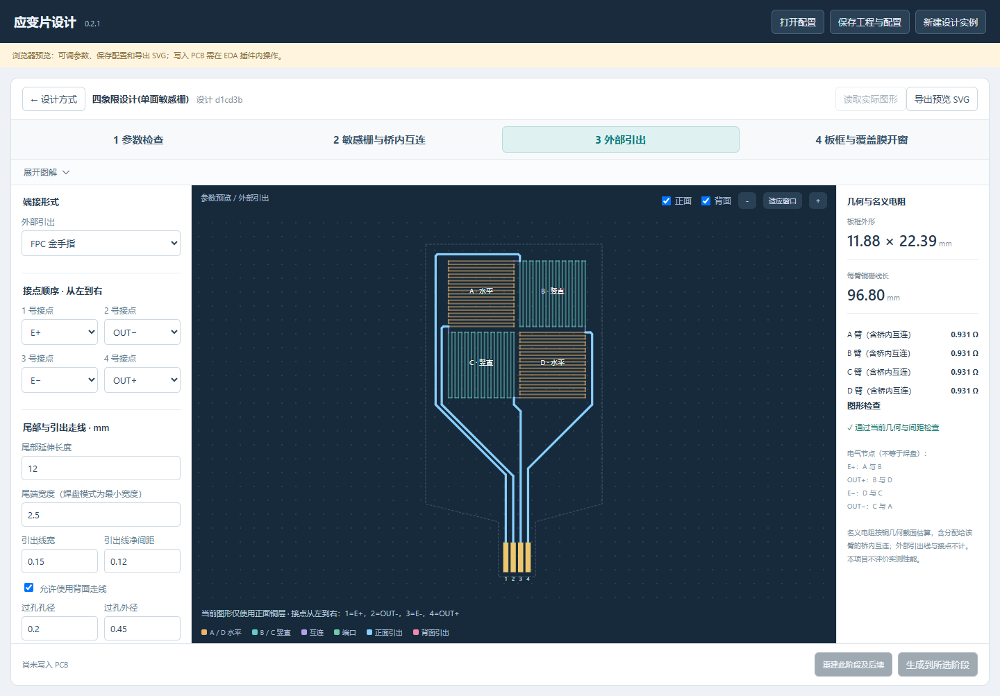

# EasyEDA Strain Gauge Designer

> A parametric **metal strain-gauge** design plugin for **JLCEDA / EasyEDA Pro**.

**English** · [简体中文](README.zh-CN.md)

[Design workflow](#1-design-workflow) · [Installation and getting started](#2-installation-and-getting-started) · [Manual wiring](#3-manual-wiring-in-eda) · [Configuration and editing](#4-configuration-and-manual-editing) · [User guide — 中文](USER_GUIDE.md) · [Changelog — 中文](CHANGELOG.md)

**[v0.2.1 pre-release](https://github.com/G-dab/easyeda-strain-gauge-designer/releases/tag/v0.2.1)** · [Download the extension](https://github.com/G-dab/easyeda-strain-gauge-designer/releases/download/v0.2.1/strain-bridge-designer_v0.2.1.eext)



## 1. Design workflow

| Step | Design controls |
| --- | --- |
| 1. Parameter check | Copper thickness for resistance estimation and PCB placement origin |
| 2. Grids and bridge interconnections | Grid length/count, trace width, edge-to-edge spacing, spacing between adjacent grids and bridge connection width |
| 3. External terminals | Terminal type, contact order, tail dimensions, lead routing and via settings |
| 4. Board outline and coverlay openings | Copper-to-board-edge clearance and the body/tail outline; contact openings are created with the contacts |

## 2. Installation and getting started

### 2.1 Requirements

- Source builds and browser preview: **Node.js 20.17.0 or later**, with npm, and Git.
- **JLCEDA / EasyEDA Pro desktop**, targeting version **4.1.60 or later**, to draw into a PCB.

Installing the prebuilt extension requires only EDA; Node.js and Git are for source development. Browser preview requires neither EDA nor Python. PCB drawing runs through the EDA extension API.

### 2.2 Download and install (recommended)

Download [`strain-bridge-designer_v0.2.1.eext`](https://github.com/G-dab/easyeda-strain-gauge-designer/releases/download/v0.2.1/strain-bridge-designer_v0.2.1.eext) from the [v0.2.1 release](https://github.com/G-dab/easyeda-strain-gauge-designer/releases/tag/v0.2.1), then import it through the EDA extension manager. Open a separate PCB document and choose **应变片设计 → 打开设计器** (Strain Gauge Design → Open Designer).

This is an early-access pre-release. Software and browser checks have passed; full client drawing, saving and readback still need verification. Before manual wiring, follow the [Remove Loops instructions](#3-manual-wiring-in-eda).

### 2.3 Obtain the source

```sh
git clone https://github.com/G-dab/easyeda-strain-gauge-designer.git
cd easyeda-strain-gauge-designer
npm ci
```

### 2.4 Try the browser preview

```sh
npm run preview
```

Open <http://127.0.0.1:8766/designer.html>. The command builds the UI and starts a local-only server; press Ctrl+C to stop it. If the port is occupied:

```sh
npm run preview -- --port 8767
```

The browser supports parameter editing, configuration import/export and SVG export. Drawing into a PCB is available inside the EDA extension.

### 2.5 Build and install from source

```sh
npm run build
```

Import `build/dist/strain-bridge-designer_v0.2.1.eext` through the EDA extension manager. Open a separate PCB document, then choose **应变片设计 → 打开设计器** (Strain Gauge Design → Open Designer).

Select the design template, adjust parameters and click **生成到所选阶段** (Generate to selected stage). Generation fills in unfinished earlier stages and stops at the selected stage. Minimize the extension window to edit the PCB manually.

The release includes a SHA-256 checksum file. Extension packages, dependencies, caches and generated files are excluded from the source repository.

## 3. Manual wiring in EDA

> **Before connecting an external terminal, turn off 布线 → 移除回路 (Routing → Remove Loops).**

The bridge deliberately contains continuous resistive copper paths. EDA's loop-removal function may treat them as ordinary redundant routing and delete the bridge or vias when a new trace connects. A client test confirmed that disabling this setting allowed wiring while retaining the bridge. See the [official Remove Loops documentation](https://prodocs.lceda.cn/cn/pcb/route-remove-loop/).

1. If the bridge disappears after a connection, undo with Ctrl+Z, then disable Remove Loops before retrying.
2. Read the bridge's existing `SG_<instanceID>` net name and assign it to the external terminal's intended pad. Retain the bridge net name to preserve project associations.
3. Connect to the intended bridge node. The shared EDA net is a management convention: E+, E−, OUT+ and OUT− still need separate physical leads and must not be shorted together with extra copper.
4. Inspect the bridge, connections and clearances, then save the PCB.

For a flat junction, use a short lead matching the bridge connection width, then transition to the wider external lead outside the bridge. A wide trace ending directly on a thin trace can leave a rounded copper protrusion. Change the width for subsequent routing while drawing; editing the properties of an entire selected route can change its full width.

## 4. Configuration and manual editing

Use **保存工程与配置** (Save project and configuration) and keep the `.strain.json` file with the EDA project. Use **读取实际图形** (Read actual geometry) after manual edits; **重建此阶段及后续** (Rebuild this stage and later stages) explicitly replaces associated geometry from the selected stage onward.

| Resource | Contents |
| --- | --- |
| [User guide — Chinese](USER_GUIDE.md) | Parameters, node mapping, manufacturing notes and manual-edit protection |
| [FPC contact-finger example](examples/fpc-fingers.strain.json) | Unbound configuration with a bottom contact tail |
| [Bridge-only example](examples/default-bridge.strain.json) | Unbound configuration without external terminals |
| [Changelog — Chinese](CHANGELOG.md) | Project development history |

Version 2 configurations from 0.2.0 retain their original routing until the external-terminal stage, or an earlier stage, is explicitly rebuilt. Generated projects using the older version 1 configuration still require their original plugin and project files.

## Credits and license

Developed from the official [easyeda-api-sdk](https://github.com/easyeda/easyeda-api-sdk), with upstream copyright retained under [Apache-2.0](LICENSE). Archived SDK documentation is in [docs/upstream-sdk](docs/upstream-sdk/README.md).
