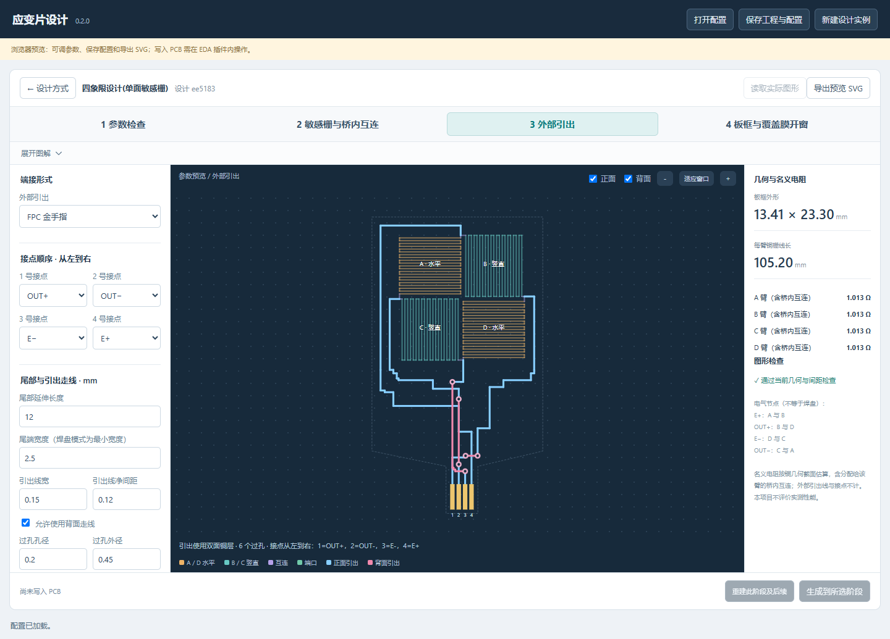

# EasyEDA Strain Gauge Designer · 应变片设计

嘉立创 EDA 专业版的参数化应变片设计插件。

A parametric copper strain-gauge designer for JLCEDA / EasyEDA Pro, with staged drawing and optional two-layer terminal routing.

## 当前状态

当前代码版本 **0.2.0，开发中**。仓库暂为私有，尚未发布 Release。真实 EDA 客户端中的新版本绘图、保存和回读仍需复测；本项目不评价加工后的灵敏度、温漂或标定效果。

## 功能

- 四象限正交桥芯：四个蛇形敏感栅紧凑互连，敏感栅位于正面铜层。
- 四步设计：参数检查 → 敏感栅与桥内互连 → 外部引出 → 板框与覆盖膜开窗。
- 参数面板按步骤切换，提供可展开的参数图解和几何预览。
- 下方尾部支持焊接焊盘或尺寸可调的 FPC 金手指，四接点顺序可调整。
- 引出优先使用正面，必要时自动添加通孔和背面线路；可关闭背面走线。
- 正面／背面独立勾选，支持叠加显示。
- 保存配置与图元关联，支持实际图形回读、按影响阶段重建及手改保护。



## 环境要求

- Node.js **20.17.0 或以上**，以及随 Node 提供的 npm。
- Git，用于获取与管理源码。
- 实际绘制 PCB 需要嘉立创 EDA 专业版桌面客户端；目标 API 版本 **4.1.60 或以上**。
- 浏览器预览不需要 Python，也不需要安装 EDA。

## 本地预览

获取项目并在仓库根目录运行：

```sh
git clone https://github.com/G-dab/easyeda-strain-gauge-designer.git
cd easyeda-strain-gauge-designer
npm ci
npm run preview
```

然后打开 <http://127.0.0.1:8766/designer.html>。此命令会先构建界面，再启动仅监听本机的预览服务器。按 Ctrl+C 停止。

如果端口已被占用：

```sh
npm run preview -- --port 8767
```

浏览器支持参数设计、配置导入导出和 SVG 预览；“生成到所选阶段”只能在 EDA 插件内使用。

## 构建和安装插件

目前没有发布可下载的 Release，需从源码构建：

```sh
npm ci
npm run build
```

构建产物为 `build/dist/strain-bridge-designer_v0.2.0.eext`。在嘉立创 EDA 的扩展管理器导入该文件，打开独立 PCB，再通过“应变片设计 → 打开设计器”使用。

插件安装包、依赖、缓存和生成文件不提交到源码仓库；后续发布时再将安装包附在 Releases。

## 使用与配置

- [完整使用说明](USER_GUIDE.md)
- [金手指示例配置](examples/fpc-fingers.strain.json)
- [仅桥芯示例配置](examples/default-bridge.strain.json)
- [项目更新记录](CHANGELOG.md)

示例配置没有关联 PCB，可在浏览器或插件内打开。0.2.0 使用版本 2 配置；旧版已生成工程请继续保留旧插件和原配置，新版另建实例，避免误改既有图形。

## 检查与测试

```sh
npm run lint
npm run typecheck
npm test
npm run build
```

17 项软件测试覆盖桥芯几何、焊盘与金手指各 24 种接点顺序、分层连通、过孔增删、手改保护、阶段重建和中途失败恢复。EDA API 测试使用模拟接口，不能替代真实客户端验证。

## 源码结构

| 路径 | 内容 |
| --- | --- |
| `src/geometry.ts` | 参数、桥芯／尾部几何与检查 |
| `src/tail-router.ts` | 有界双层引出路由 |
| `src/adapter.ts` | EDA 图元、回读、配置与重建 |
| `src/designer.html`、`src/ui.ts` | 界面源码与交互 |
| `src/parameter-guide.ts` | 参数图解 |
| `scripts/` | 界面构建、本地预览和测试工具 |
| `tests/` | 软件回归测试 |
| `build/`、`config/` | 基于官方 SDK 的构建工具 |

`iframe/designer.html`、`iframe/app.js` 和 `dist/` 是生成文件，克隆后由构建命令生成。

## 来源与许可证

本项目基于官方 [easyeda-api-sdk](https://github.com/easyeda/easyeda-api-sdk) 开发，作为独立项目维护，保留上游版权和 [Apache-2.0 许可证](LICENSE)。上游脚手架的旧说明归档于 [docs/upstream-sdk](docs/upstream-sdk/README.md)，不代表本项目已提供对应语言的翻译。
