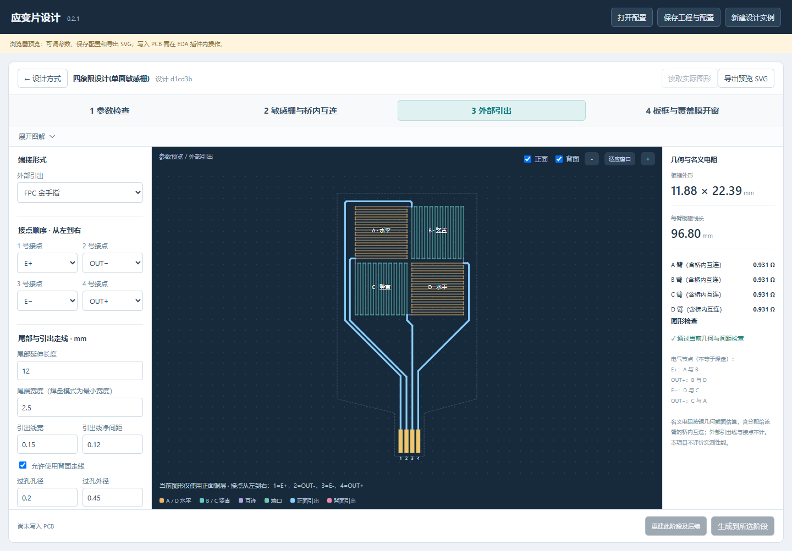

# EasyEDA Strain Gauge Designer · 应变片设计

> 面向 **嘉立创 EDA 专业版** 的参数化 **金属应变片** 设计插件。

[English](README.md) · **简体中文**

[设计流程](#1-设计流程) · [安装与开始使用](#2-安装与开始使用) · [手动接线](#3-在-eda-中手动接线) · [配置与手动编辑](#4-配置与手动编辑) · [完整使用说明](USER_GUIDE.md) · [更新记录](CHANGELOG.md)

**[v0.2.1 预发布版](https://github.com/G-dab/easyeda-strain-gauge-designer/releases/tag/v0.2.1)** · [下载插件安装包](https://github.com/G-dab/easyeda-strain-gauge-designer/releases/download/v0.2.1/strain-bridge-designer_v0.2.1.eext)



## 1. 设计流程

| 步骤 | 设计内容 |
| --- | --- |
| 1. 参数检查 | 铜厚（估算电阻）、PCB 放置原点 |
| 2. 敏感栅与桥内互连 | 栅长、条数、线宽、净间距、相邻敏感栅间隔及互连线宽 |
| 3. 外部引出 | 端接形式、接点顺序、尾部尺寸、引出线及过孔设置 |
| 4. 板框与覆盖膜开窗 | 铜到板边预留及主体／尾部板框；接点开窗随接点生成 |

## 2. 安装与开始使用

### 2.1 环境要求

- 源码构建与浏览器预览需要 **Node.js 20.17.0 或以上**、npm，以及获取源码所需的 Git。
- 实际绘制 PCB 需要 **嘉立创 EDA 专业版桌面客户端**，目标版本 **4.1.60 或以上**。

直接安装预构建插件只需 EDA，Node.js 和 Git 用于源码开发。浏览器预览不需要 EDA 或 Python，PCB 绘制通过 EDA 扩展 API 完成。

### 2.2 下载安装包（推荐）

从 [v0.2.1 发布页](https://github.com/G-dab/easyeda-strain-gauge-designer/releases/tag/v0.2.1) 下载 [`strain-bridge-designer_v0.2.1.eext`](https://github.com/G-dab/easyeda-strain-gauge-designer/releases/download/v0.2.1/strain-bridge-designer_v0.2.1.eext)，在 EDA 扩展管理器中导入。打开独立 PCB 文档，通过 **应变片设计 → 打开设计器** 使用。

本次为体验性质的预发布版。软件与浏览器检查已通过，完整客户端绘图、保存、回读仍需进一步验证。手动接线前，请按[接线说明](#3-在-eda-中手动接线)关闭“移除回路”。

### 2.3 获取源码

```sh
git clone https://github.com/G-dab/easyeda-strain-gauge-designer.git
cd easyeda-strain-gauge-designer
npm ci
```

### 2.4 体验浏览器预览

```sh
npm run preview
```

打开 <http://127.0.0.1:8766/designer.html>。此命令先构建界面，再启动仅监听本机的服务器；按 Ctrl+C 停止。端口被占用时：

```sh
npm run preview -- --port 8767
```

浏览器支持参数编辑、配置导入导出和 SVG 导出。写入 PCB 的操作在 EDA 插件内使用。

### 2.5 从源码构建并安装插件

```sh
npm run build
```

在 EDA 扩展管理器导入 `build/dist/strain-bridge-designer_v0.2.1.eext`。打开独立 PCB 文档，再通过 **应变片设计 → 打开设计器** 进入插件。

选择设计模板、调整参数，点击 **生成到所选阶段**。程序补齐尚未完成的前序阶段，并在指定阶段停止。最小化插件窗口后，即可在 PCB 中手动编辑。

发布页附有 SHA-256 校验文件。插件安装包、依赖、缓存和生成文件不提交到源码仓库。

## 3. 在 EDA 中手动接线

> **连接外部端子前，先关闭“布线 → 移除回路”。**

桥体包含有意保留的连续电阻铜图形。EDA 的自动删环可能将其当作普通冗余布线，在新线接入时删除桥体或过孔。已有客户端测试确认，关闭该选项后可以接线并保留桥体。参考[官方“移除回路”说明](https://prodocs.lceda.cn/cn/pcb/route-remove-loop/)。

1. 若桥体在接线后消失，先按 Ctrl+Z 撤销，再关闭“移除回路”后重试。
2. 读取桥体原有的 `SG_<实例ID>` 网名，将新端子的目标焊盘设为该网络。保留桥体网名，以维持配置关联。
3. 连接到正确的桥路节点。共用 EDA 网络是管理方式，E+、E−、OUT+、OUT− 仍须分别引出，不能用额外铜线将它们短接。
4. 检查桥体、连接及间距，然后保存 PCB。

需要平整接入时，先用与桥内互连同宽的短线连接节点，再在桥体外侧过渡到较宽引出线。粗线直接结束在细线上时，圆形端帽可能形成凸起。应在布线过程中切换后续线宽；选中整条已有导线修改属性，可能改变整条线宽。

## 4. 配置与手动编辑

使用 **保存工程与配置**，将 `.strain.json` 与 EDA 工程配套保存。手改后可用 **读取实际图形** 回读；**重建此阶段及后续** 会明确替换选定阶段及后续的关联图形。

| 资料 | 内容 |
| --- | --- |
| [完整使用说明](USER_GUIDE.md) | 参数、节点定义、制造备注与手改保护 |
| [FPC 金手指示例](examples/fpc-fingers.strain.json) | 尚未绑定 PCB 的下方接触尾部配置 |
| [仅桥芯示例](examples/default-bridge.strain.json) | 尚未绑定 PCB、不添加外部端接的配置 |
| [更新记录](CHANGELOG.md) | 项目开发记录 |

0.2.0 的版本 2 配置继续保留原路由，明确重建“外部引出”或更早阶段才应用新路由。更早的版本 1 已生成工程仍需保留原插件及原工程文件。

## 致谢与许可证

本项目基于官方 [easyeda-api-sdk](https://github.com/easyeda/easyeda-api-sdk) 开发，保留上游版权，使用 [Apache-2.0 许可证](LICENSE)。旧 SDK 文档归档于 [docs/upstream-sdk](docs/upstream-sdk/README.md)。
